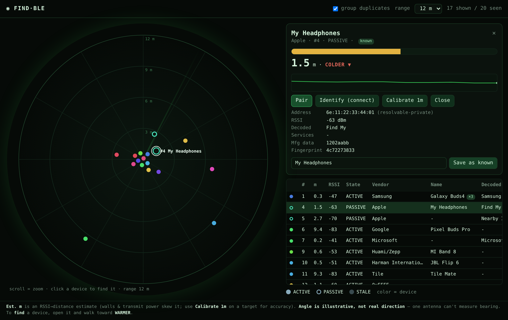

# Find-BLE — Bluetooth device finder & radar

A passive **Bluetooth Low Energy (BLE) scanner, radar map, and proximity finder**
that runs entirely on your laptop. It listens to the advertising packets nearby
devices already broadcast, maps them live, resolves their manufacturers, and
helps you **home in on a specific device** ("warmer / colder") to locate it.

Built as a hands-on security/networking project to explore what BLE devices
reveal in the open air — and how proximity-based "find my device" actually works
without any special hardware.



---

## Features

- **Live radar map** of nearby BLE devices, positioned by signal strength, with
  smooth motion and collision-declutter so crowded scans stay readable.
- **Proximity finder** — select a device and walk toward **WARMER**: a live
  signal meter, estimated distance, rising/falling trend, and an RSSI sparkline.
- **Calibrate at 1 m** — pin a known distance once and that device's range
  estimate becomes genuinely accurate.
- **Full vendor resolution** — bundled IEEE/Bluetooth-SIG databases (~4,000
  companies) name the maker of almost any device; unknown IDs fall back to raw
  hex, never a guess.
- **Protocol decoding** — Apple Continuity (Find My, Nearby Info, Handoff,
  Proximity Pairing…), Google Fast Pair, Eddystone, Tile, Microsoft Swift Pair,
  Samsung, and more.
- **Duplicate grouping** — collapses the multiple advertisers of one earbud set
  (left / right / case / LE) into a single entry.
- **Identify (connect)** — optionally connect once over GATT to read a device's
  real name / model / manufacturer / appearance when it advertises none.
- **Pair** — send a real BLE pairing request to a device in pairing mode.
- **Unknown-device characterization** — when nothing matches a database, it
  still shows the **address type** (public / resolvable-private / random-static /
  OS-masked), a **Fast Pair model ID**, and a stable **advertisement
  fingerprint**, instead of a blank.
- **Local learning** — **Save as known** labels a device once (by address or
  fingerprint) and recognizes it on every future scan. Your labels, stored
  locally.
- **State awareness** — ACTIVE / PASSIVE (background beacons, the "looks off but
  still transmitting" case) / STALE (gone quiet).

## Tech stack

Python 3 standard library + [`bleak`](https://github.com/hbldh/bleak) for
cross-platform BLE, a dependency-free HTML/Canvas/JS front end served locally,
and bundled vendor databases. No frameworks, no build step, no cloud.

---

## Quick start

```bash
# 1. clone and enter
git clone https://github.com/<your-username>/ble-finder.git
cd ble-finder

# 2. (recommended) virtual environment
python3 -m venv .venv
source .venv/bin/activate          # Windows: .venv\Scripts\activate

# 3. install the one dependency
pip install -r requirements.txt

# 4a. try it immediately with synthetic devices (no Bluetooth needed)
python3 server.py --demo

# 4b. or run a real scan of your surroundings
python3 server.py
```

It opens `http://127.0.0.1:8500` automatically. Options:
`--port --range --tx --n --smooth --stale` (see `python3 server.py --help`).

**Platform notes**
- **macOS** prompts for Bluetooth permission for your terminal on first run.
- **Linux** needs BlueZ running; for scanning without root:
  `sudo setcap 'cap_net_raw,cap_net_admin+eip' $(readlink -f $(which python3))`.
- **Windows** works out of the box on Windows 10/11 with built-in Bluetooth.

## Finding a lost device

1. Click the device in the list or on the radar to open the **Find** panel.
2. If you can get ~1 m from it once, click **Calibrate 1m** for accurate range.
3. Walk around watching the meter and the **WARMER / COLDER** readout — signal
   peaks when you are closest.
4. Use **Identify** to confirm its name if it doesn't advertise one.

## Unknown devices & local learning

Not every device is in a database, so Find-BLE degrades gracefully from
*naming* a device to *characterizing* it:

- **Address type** reveals whether an address is vendor-assigned (public) or a
  rotating privacy address — useful even with no name.
- An **advertisement fingerprint** (a hash of the packet's structure) is stable
  per product, so two identical units cluster together and a single device is
  recognizable over time.
- **Save as known** lets you label an unknown device once; it's matched by
  address (if stable) or fingerprint on future scans and stored in
  `data/known_devices.json` (git-ignored — it's your data).

## Updating the databases

Vendor and service names come from bundled databases that you can refresh:

```bash
python3 update_data.py
```

This pulls the latest from the upstream source into `data/`. Provenance and
licenses are documented in [`data/SOURCES.md`](data/SOURCES.md). Only data that
is licensed for redistribution is bundled.

---

## How it works

BLE devices constantly broadcast small **advertising packets** (no pairing or
connection required). Find-BLE listens passively and decodes each one:

- **Vendor** from the manufacturer-data company ID (bundled SIG database).
- **Device type / protocol** from Apple Continuity TLVs, service UUIDs, and
  service data.
- **Signal strength (RSSI)** → a smoothed **distance estimate** via the standard
  log-distance path-loss model `d = 10 ^ ((txPower1m − RSSI) / (10·n))`.

The radar places each device at that estimated distance from the center. A
per-device RSSI history drives the finder's trend and sparkline.

### Project structure

```
ble-finder/
├── server.py        # HTTP server, scan loop, REST API, --demo mode
├── scanner.py       # decoding, device store, distance, history, grouping,
│                    #   address-type, fingerprint, known-device labels
├── enrich.py        # optional GATT Identify + Pair (active connect)
├── update_data.py   # refresh the bundled databases from upstream
├── static/          # web app: index.html, style.css, app.js (Canvas radar)
├── data/            # bundled vendor + service UUID databases (+ SOURCES.md)
└── requirements.txt
```

---

## Honest limitations

This project is deliberate about what signal data can and cannot do:

- **No direction.** A single antenna cannot measure bearing, so the radar
  **angle is illustrative, not real direction**. Finding works by proximity
  (warmer/colder), not by pointing. True direction finding needs Bluetooth 5.1
  AoA hardware with an antenna array.
- **Distance is an estimate.** Walls, bodies, and each device's transmit power
  skew RSSI; per-device calibration helps but it is never exact.
- **Private addresses.** Modern phones rotate their BLE address every ~15 min,
  so they usually can't be tracked over time from the address alone.
- **Grouping is heuristic** (based on advertised name) and can miss devices that
  rotate names or advertise none.
- A device with Bluetooth truly off, or out of range, cannot be seen at all.

## Ethics & scope

Find-BLE only **receives** broadcast advertising data that is already public in
the air; it never transmits except for the **Identify** and **Pair** actions you
explicitly trigger on a device you select. Use it on your own devices and for
learning. Don't use it to track or interfere with other people's devices.

## Data sources

Vendor and service names are derived from Nordic Semiconductor's
[`bluetooth-numbers-database`](https://github.com/NordicSemiconductor/bluetooth-numbers-database)
(built from the Bluetooth SIG assigned numbers), bundled under `data/`.

## License

[MIT](LICENSE) © 2026 Aayush Yadav
